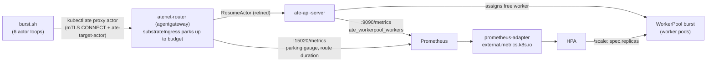

# Burst Without 503s: Request Parking + an Autoscaled WorkerPool

This lab essentially answers two questions:
  1. What happens when a new request for an Actor comes in, but there aren't any free Wortkers for the Actor to run on
  2. How HPA comes into play to scale up Workers/Worker Pools so when new requests for an Actor come in, they aren't sitting and waiting

Tldr; when more agents want to run than you have warm workers, Substrate has
two answers on two time scales:

- The **router parks** a request for a few seconds while a worker frees up.
- An **HPA grows the WorkerPool** when the pool stays full.

This lab shows each one alone, where each one fails, and then both together.

The router here is **agentgateway**: Substrate installed with
`--atenet-dataplane=agentgateway`, where agentgateway's `substrateIngress`
policy resumes actors and does the parking.

## Key terms

**Parked request.** A request for an actor that has no worker yet.

**Park budget** (just "budget" in this lab). The longest the router keeps a
parked request waiting. The clock starts when the router first tries to resume
the actor.

- A worker frees up within the budget: the request is served with `200`, late
  by however long it waited.
- The budget runs out first: the router gives up and returns `503` ("no worker
  has room for the actor"), about one budget after the request arrived.

Requests for the same actor that arrive while it is parked wait on the same
resume and end with it.

It is the `budget` field of agentgateway's `substrateIngress.requestParking`
setting, which defaults to `5s`. `./scripts/router-parking.sh budget <secs>`
changes it. Your clients need timeouts longer than the budget, or they give up
before the router does.

**Parking off.** The sibling setting `requestParking.max` caps how many
requests can be parked at once (default `1024`). `max: 0` turns parking off: a
request that finds no free worker gets the same `503` right away, with no wait.
With agentgateway v1.7.0 (the image Substrate v1.0.0 installs) the status code
is the same either way, so this lab tells the two apart by how long the `503`
took.

## What this lab proves

1. **Parking absorbs short contention.** With 6 actors on 2 workers and actors
   that keep suspending, every request returns `200`. Turn parking off and the
   same load returns fast `503`s.
2. **Parking does not add capacity.** When actors stay hot, a 5s park budget
   runs out and requests fail with `503` after waiting it out. The pool is
   simply too small.
3. **The HPA adds capacity.** `ate-api-server` exports
   `ate_workerpool_workers`, a worker count per pool and state. prometheus-adapter
   serves the busy ones (`partial` + `at_capacity`) to an HPA that writes
   `WorkerPool.spec.replicas`. The pool grows from 2 to 8 and the `503`s stop.
4. **Together they cover the gap.** Raise the park budget to cover the HPA's
   scale-up time, and a burst that starts on 2 workers is served while the
   pool grows, with far fewer `503`s.

## What Substrate pieces this uses

| Piece | Role in this lab | Source |
|---|---|---|
| `WorkerPool` (`ate.dev/v1`) | Warm worker pods. Has a `/scale` subresource (`specpath=.spec.replicas`), so an HPA can target it directly. | `api/infra/k8s/ate/v1/workerpool_types.go` |
| ActorTemplate (ate API, not a CRD) | The counter workload, created with `kubectl ate create actor-template`. | `manifests/actortemplate.yaml.tmpl` |
| agentgateway dataplane for atenet | `--atenet-dataplane=agentgateway` swaps the `atenet-router` Deployment's containers for a single `agentgateway` container (v1.7.0). Its config is the ConfigMap `ate-system/atenet-router-agentgateway-config`: an mTLS-only HTTPS gateway on 8443 and a CONNECT listener on 8444, both limited to `--ingress-allowed-spiffe-ids`. | `manifests/ate-install/components/agentgateway/`, `.../agentgateway-static-mtls/` |
| `substrateIngress.requestParking` | On a retryable resume failure (`ResourceExhausted`, `FailedPrecondition`, `Unavailable`) agentgateway holds the request and retries `ResumeActor` until `budget` (default `5s`) runs out, then returns `503` "no worker has room for the actor". `max` (default `1024`) caps waiting requests; `max: 0` turns parking off. On by default. | agentgateway `crates/agentgateway/src/http/substrate/ingress.rs` |
| `ate.workerpool.workers` metric | Worker count per pool, state (`idle`, `partial`, `at_capacity`, `unschedulable`) and sandbox class. Exported as `ate_workerpool_workers` on `ate-api-server:9090/metrics`. | `cmd/ateapi/internal/controlapi/metrics.go` |
| Worker capacity | A gVisor worker offers 1000 actor slots (`ateworker-gvisor --max-actors`) and reports its worker container's CPU and memory limits. The scheduler places an actor only where its template's `resources.limits` still fit. This lab sizes both so each worker holds one actor. | `cmd/ateapi/internal/scheduling/scheduling.go` |
| Router metrics | `agentgateway_substrate_request_parking_active` (gauge) and `agentgateway_atenet_router_route_duration_seconds` (labels `ate_router_outcome`, `ate_router_resume`), on the router pod's `:15020/metrics`. | agentgateway `crates/agentgateway/src/telemetry/metrics.rs` |
| HPA + prometheus-adapter | External metric, `AverageValue` target, adapted from the pre-1.0 upstream demo. | `demos/autoscaled-workerpool/` (not in v1.0.0) |

## How the two mechanisms fit



*The request path (top) and the capacity loop (bottom). Parking works on the
request path in seconds. The HPA works on the capacity loop in tens of
seconds.*

They work on different time scales:

| | Request parking | HPA on busy workers |
|---|---|---|
| Reacts in | ~100ms retries | scrape (15s) + HPA sync (~15s) + worker pod start |
| Fixes | moments of contention: a worker frees up soon | lasting demand: you need more workers |
| Fails as | `503` once the budget runs out | `503`s while the pool is still growing |

---

## Prerequisites

1. Cluster

- A **GKE Standard** cluster with Agent Substrate **v1.0.0** installed and
  healthy, set up as in the [setup lab](../install-and-setup/setup-gke.md)
  (`go run ./cmd/ate-setup deploy ate-system ...` from a `v1.0.0` checkout).
  Build the counter image below from the same checkout you installed from.
- The **agentgateway** router dataplane. Add these flags to your
  `ate-setup deploy ate-system` command (or re-run it with them):
  `--atenet-dataplane=agentgateway --credential-provider='{"enabled":false}'
  --ingress-allowed-spiffe-ids=spiffe://cluster.local/ns/ate-system/sa/atenet-client`.
  `--credential-provider` is required. This lab doesn't use egress credential
  injection, so it turns it off; `'{"name":"k8s.io"}'` also works on
  agentgateway. The SPIFFE ID is the client
  certificate `kubectl ate proxy` presents; without it the router lets no
  client reach actors. The `atenet-router` Deployment then runs a single
  `agentgateway` container.
- The snapshot location from setup (`SNAPSHOT_LOCATION`, the
  `--snapshot-location` ate-api-server writes snapshots under), with IAM
  already granted.
- `kubectl ate` from the same v1.0.0 checkout (`go install ./cmd/kubectl-ate`).
  `kubectl ate proxy` needs permission to create, get and delete
  `podcertificaterequests` in `ate-system`; a cluster admin has it.

Health check before you start:

```bash
kubectl get pods -n ate-system
kubectl -n ate-system get deploy atenet-router \
  -o jsonpath='{.spec.template.spec.containers[*].name}{"\n"}'
# expect: agentgateway
kubectl ate get atespaces
```

---

## Environment

```bash
export SUBSTRATE_DIR=~/gitrepos/substrate            # your Substrate checkout (v1.0.0)
export KO_DOCKER_REPO=gcr.io/<project-id>/ate-images  # same as setup
export SNAPSHOT_LOCATION=gs://<your-snapshot-bucket>/ # same as setup

cd ~/gitrepos/agentic-demo-repo/substrate/autoscaling
```

Every command below runs from this `autoscaling/` directory.

## Step 1: Build the worker and workload images

The pool needs the `ateworker-gvisor` worker image, and the template needs the
upstream counter workload. Build both from the checkout you installed from, so
the worker matches the control plane version. `ko build` prints the pushed
image reference (with digest) on stdout.

```bash
git clone --branch v1.0.0 https://github.com/agent-substrate/substrate

cd substrate
```

```bash
export WORKER_IMAGE=$(cd "$SUBSTRATE_DIR" && \
  ./hack/run-tool.sh ko build --platform=linux/amd64 ./cmd/ateworker-gvisor)
export COUNTER_IMAGE=$(cd "$SUBSTRATE_DIR" && \
  ./hack/run-tool.sh ko build --platform=linux/amd64 ./demos/counter)

echo "WORKER_IMAGE=$WORKER_IMAGE"
echo "COUNTER_IMAGE=$COUNTER_IMAGE"
```

> Installed from the published release images instead? The worker is published
> too, so you can skip its build:
> `export WORKER_IMAGE=ghcr.io/agent-substrate/substrate/ateworker-gvisor:v1.0.0`.
> Demo images like the counter are not published, so it still needs `ko build`.

> Already running another pool built from the same install? You can reuse its
> worker image:
> `kubectl get workerpools -A -o custom-columns=NS:.metadata.namespace,NAME:.metadata.name,IMAGE:.spec.workerImage`

## Step 2: Deploy the pool, atespace, and template

```bash
# Namespace + 2-worker WorkerPool
envsubst '${WORKER_IMAGE}' < manifests/workerpool.yaml.tmpl | kubectl apply -f -
kubectl -n ate-lab-burst rollout status deployment/burst --timeout=10m

# Atespace + ActorTemplate (through the ate API)
kubectl ate create atespace ate-lab-burst
envsubst '${COUNTER_IMAGE}' < manifests/actortemplate.yaml.tmpl \
  | kubectl ate create actor-template -f -
```

Creating the template starts the **golden snapshot** build. The template can
be used once `GOLDEN TAG` is filled in:

```bash
kubectl ate get actor-templates -a ate-lab-burst
```

To wait for it from a script, poll the template until `goldenTag` appears and
stop on a build error (up to 15 minutes):

```bash
for i in $(seq 1 180); do
  out=$(kubectl ate get actor-template burst -a ate-lab-burst -o yaml)
  echo "$out" | grep -q 'errorMessage:' && { echo "$out"; break; }
  echo "$out" | grep -q 'goldenTag:' && { echo "golden snapshot ready"; break; }
  sleep 5
done
```

Confirm both workers registered and are free:

```bash
kubectl ate get workers -n ate-lab-burst
```

## Step 3: Create six actors

Six actors, two workers: oversubscribed 3:1.

That only holds because each worker fits one actor. A gVisor worker offers
1000 actor slots, so on slots alone all six actors would share the two workers
and nothing would ever wait. The pool caps each worker at 1Gi of memory
(`manifests/workerpool.yaml.tmpl`), and the template asks for 768Mi per actor
(`manifests/actortemplate.yaml.tmpl`). The scheduler only places an actor where
its memory still fits, so a second actor never does.

```bash
for i in 1 2 3 4 5 6; do
  kubectl ate create actor "a$i" -a ate-lab-burst --template burst
done
kubectl ate get actors -a ate-lab-burst
```

All six start in `ACTOR_STATE_SUSPENDED`. They exist only as records, plus the
golden snapshot in GCS.

Keep a helper handy. You will reset to "everything suspended" between scenarios:

```bash
suspend_all() {
  for i in 1 2 3 4 5 6; do
    kubectl ate suspend actor "a$i" -a ate-lab-burst >/dev/null 2>&1 || true
  done
  kubectl ate get actors -a ate-lab-burst
}
```

## Step 4: Install Prometheus, prometheus-adapter, and check the metric

Preflight: make sure nothing else owns the external metrics API.

```bash
kubectl get apiservice v1beta1.external.metrics.k8s.io 2>/dev/null \
  && echo "STOP: another external-metrics adapter owns this API; see Prerequisites" \
  || echo "OK: external metrics API is free"
```

Deploy:

```bash
kubectl apply -f manifests/prometheus.yaml
kubectl -n ate-lab-burst-monitoring rollout status deployment/prometheus --timeout=5m

kubectl apply -f manifests/prometheus-adapter.yaml
kubectl -n ate-lab-burst-monitoring rollout status deployment/prometheus-adapter --timeout=5m
kubectl wait --for=condition=Available apiservice/v1beta1.external.metrics.k8s.io --timeout=5m
```

Check that Prometheus scrapes both Substrate components. Open a forward in a
spare terminal and leave it running for the rest of the lab:

```bash
kubectl -n ate-lab-burst-monitoring port-forward svc/prometheus 9091:9090
```

```bash
curl -s localhost:9091/api/v1/targets \
  | jq -r '.data.activeTargets[] | "\(.labels.app)\t\(.labels.pod)\t\(.health)"'
# expect ate-api-server (x2) and atenet-router, all "up"

curl -s localhost:9091/api/v1/query \
  --data-urlencode 'query=sum by (ate_worker_state) (max by (ate_worker_state, ate_sandbox_class) (ate_workerpool_workers{ate_workerpool_namespace="ate-lab-burst",ate_workerpool_name="burst"}))' \
  | jq -r '.data.result[] | "\(.metric.ate_worker_state)\t\(.value[1])"'
# with everything suspended: idle 2, partial 0, at_capacity 0, unschedulable 0
```

Both ate-api-server replicas report the same count, so `max` removes the
duplicate; `sum` then adds up the sandbox classes.

Also confirm the router's agentgateway metrics are there (Prometheus scrapes
the router pod on `:15020`):

```bash
curl -s localhost:9091/api/v1/label/__name__/values \
  | jq -r '.data[] | select(startswith("agentgateway_substrate") or startswith("agentgateway_atenet_router"))'
# expect agentgateway_substrate_request_parking_active and
# agentgateway_atenet_router_route_duration_seconds_{bucket,count,sum}
```

---

## Scenario 1: Parking absorbs short contention

### a. Watch one request park

The router has no plaintext port in v1.0.0. `kubectl ate proxy actor` opens a
local port per actor and tunnels each connection to the router over mTLS,
setting `ate-target-actor` for you. Opening a proxy doesn't resume anything;
the first request through it does.

In **terminal 1**, start proxies for `a1`, `a2` and `a3` and leave them
running:

```bash
kubectl ate proxy actor a1 8001:80 -a ate-lab-burst &
kubectl ate proxy actor a2 8002:80 -a ate-lab-burst &
kubectl ate proxy actor a3 8003:80 -a ate-lab-burst &
wait
```

In **terminal 2**, fill both workers:

```bash
curl -s http://localhost:8001
curl -s http://localhost:8002
kubectl ate get workers -n ate-lab-burst      # both ASSIGNED(1/1000)
```

Now request `a3`, timing it. The pool is full, so the request **parks** and
`curl` hangs:

```bash
curl -s -w '-> HTTP %{http_code} in %{time_total}s\n' http://localhost:8003
```

Within 5 seconds, free a worker from **terminal 3**:

```bash
kubectl ate suspend actor a1 -a ate-lab-burst
```

Back in terminal 2, the parked `curl` finishes with `HTTP 200`. Its
`time_total` is how long the request sat parked.

Missed the 5s window? The first `curl` returns `503` (`no worker has room for
the actor`) after about 5s instead. Run it again to see the `200` now that the
Worker is free:

```bash
curl -s -w '-> HTTP %{http_code} in %{time_total}s\n' http://localhost:8003
```

### b. Churn load: zero failures

`churn` mode runs one request → suspend loop per actor. Six actors fight over
two workers, but each one gives its worker back right after its request.
`burst.sh` starts its own `kubectl ate proxy actor` per actor (local ports
`18080`-`18085`, override with `BURST_LOCAL_PORT`) and stops them on exit:

```bash
./scripts/burst.sh -m churn -d 45
```

Expected shape (your counts will differ):

```text
==> results (churn, 45s, pool now 2/2)
    total requests : <n>
    200 OK         : <n>
    503 after >=1s : 0   <- parked, then the park budget ran out
    503 under 1s   : 0   <- not parked: parking off / lot full / transient / stale assignment
    504            : 0   <- the resume itself outlasted the budget
    other          : 0
    200 latency    : avg <s>  p50 <s>  p95 <s>  max <s>
    200s over 1s   : <n>   <- requests that waited (parked) before being served

    => 0 failures: every request was served.
```

The `200s over 1s` line counts requests that parked and then succeeded.
`kubectl ate proxy` opens a fresh port-forward to the router for every
connection, so every request also pays that setup time; compare against a
`hold` run on a free pool if the count looks high.

> **TODO (v1.0.0):** Re-run churn and hold on a v1.0.0 cluster and re-capture
> the sample output, the 1s threshold, and the per-request proxy overhead.
> The 503/504 split above comes from reading agentgateway v1.7.0's source, not
> from a live run.

agentgateway caches an actor's worker assignment for 5s (`cacheTtl`). In churn
mode an actor's next request often arrives within 5s of its suspend, so it
first goes to the old worker. That worker's tunnel answers `421` with
`x-ate-assignment-stale`, and agentgateway drops the cached entry and resolves
again. An occasional fast `503` in churn mode is that retry running out, not
parking.

### c. Same load, parking off

```bash
./scripts/router-parking.sh off      # sets requestParking.max: 0, restarts the router
./scripts/burst.sh -m churn -d 45
```

The failures now land in `503 under 1s`: with parking off, a request that
finds the pool full fails right away instead of waiting.

Put parking back on before Scenario 2. This restarts the router; your terminal
1 proxies survive it, because `kubectl ate proxy` picks a ready router pod for
each new connection:

```bash
./scripts/router-parking.sh default
```

---

## Scenario 2: Parking is not capacity

`hold` mode never suspends. Each actor sends a request every second and stays
hot, so the first two actors to land keep both workers:

```bash
./scripts/burst.sh -m hold -d 60
```

The live ticker shows the pool stuck at `2/2` while `503`s keep coming (each
one after waiting out the 5s budget):

```text
    t      pool s/r     200     503     504     other
    5s     2/2          <n>     <n>     0       0
    10s    2/2          <n>     <n>     0       0
    ...
```

---

## Scenario 3: The HPA adds capacity

```bash
kubectl apply -f manifests/hpa.yaml
kubectl -n ate-lab-burst get hpa burst
```

Wait until `TARGETS` shows a value (for example `0/700m (avg)`) instead of
`<unknown>`. That means the HPA can read the metric.

In a spare terminal, watch the pool:

```bash
kubectl -n ate-lab-burst get hpa burst -w
```

Run the same sustained burst that failed in Scenario 2:

```bash
./scripts/burst.sh -m hold -d 60
```

What to look for in the ticker:

- `pool s/r` climbs: `2/2 -> 3/... -> 5/... -> 8/8`, one HPA step at a time
  (see the blind spot above).
- `503` per window falls to `0` once the pool has a worker for each hot actor.
- The summary's `failure window` gives you the **time to absorb the burst**.
  Write it down in the [results table](#results-template).

At the end, six actors are running on an 8-worker pool with 2 idle workers as
headroom. It stops at 8, not `ceil(6 / 0.7) = 9`, because of the HPA's
default 10% tolerance: at 8 replicas the ratio is `6 / (0.7 × 8) ≈ 1.07`,
which is within 10% of target, so the HPA leaves the pool alone. That is
expected, not a stuck HPA.

```bash
kubectl ate get workers -n ate-lab-burst
kubectl -n ate-lab-burst get hpa burst
```

---

## Read it in Prometheus

Using the `localhost:9091` forward from Step 4, run these in the Prometheus UI
(`http://localhost:9091/graph`) or with
`curl -s localhost:9091/api/v1/query --data-urlencode 'query=...' | jq`.
Use the graph view across the time of Scenarios 1-4.

Pool occupancy by worker state. The HPA's input is `partial` plus
`at_capacity`:

```promql
sum by (ate_worker_state) (
  max by (ate_worker_state, ate_sandbox_class) (
    ate_workerpool_workers{ate_workerpool_namespace="ate-lab-burst", ate_workerpool_name="burst"}))
```

Requests waiting on a resume right now. Each router pod has its own parking
lot and reports its own gauge, so `sum` gives the total across router pods
(this install runs one):

```promql
sum(agentgateway_substrate_request_parking_active)
```

---

## Cleanup

```bash
make clean
```

Check for leftover snapshot objects under the lab's atespace prefix, and
delete them only if you are sure nothing else uses that prefix:

```bash
gcloud storage ls --recursive "${SNAPSHOT_LOCATION%/}/atespaces/ate-lab-burst/"
# gcloud storage rm -r "${SNAPSHOT_LOCATION%/}/atespaces/ate-lab-burst/"
```

---

## References

- Substrate v1.0.0: `manifests/ate-install/components/agentgateway/` and
  `.../agentgateway-static-mtls/` (the agentgateway dataplane overlays),
  `docs/reference/kubectl-ate.md` (`proxy actor`), `cmd/kubectl-ate/README.md`.
  `docs/concepts/request-parking.md` and `demos/parking/README.md` describe the
  Envoy router's parking; agentgateway's uses the same defaults (`5s`, `1024`)
  but answers a spent budget with `503` from its own status mapping.
  `demos/autoscaled-workerpool/` was removed before v1.0.0.
- agentgateway: `crates/agentgateway/src/http/substrate/ingress.rs`
  (`substrateIngress`, `requestParking`) and
  `crates/agentgateway/src/telemetry/metrics.rs`
- Kubernetes HPA external metrics:
  <https://kubernetes.io/docs/tasks/run-application/horizontal-pod-autoscale/#scaling-on-metrics-not-related-to-kubernetes-objects>
- prometheus-adapter: <https://github.com/kubernetes-sigs/prometheus-adapter>
